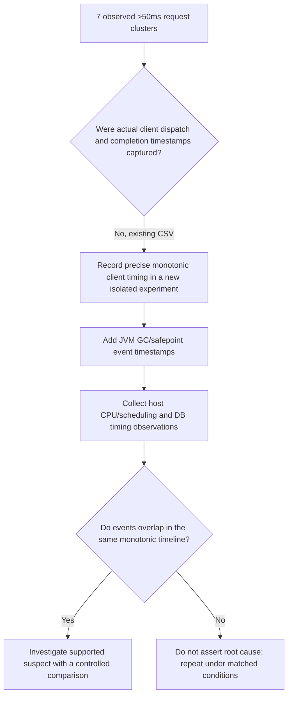

# Chapter 68 — Seven Slow-Request Clusters: Evidence Before Diagnosis

> Milestone 21 follow-up from the actual local CSV analysis on
> **2026-11-10**, tested experiment commit
> `e3c2ef2b5744acce4b3976b86cb3a08ea4ac3355`.
> The improved offline analyzer was run after pulling
> `7f4e88ad7d5d579942cb346118186492934b3ec2`.
> This is a **simulated-payment, localhost-only** learning exercise.

## The problem, in plain language

Imagine a service answers every request successfully, but every
so often a small group of requests takes much longer. This can
happen when a shared machine pauses briefly; however the *same
visible symptom* may arise from the client's execution, server
threads, the operating system, or the database.

Our challenge is to separate what we **observed** from what we
**suspect**, and to preserve the evidence before changing code
or tuning HikariCP.

## Observed findings from the local analysis

The offline CSV tool reported:
- `VALIDATED rows=6000`: **4800 GET + 1200 POST**, correct synthetic
  four-merchant distribution.
- Requests over 20 ms: **62**; over 50 ms: **37**; over 100 ms: **16**.
- All 37 over-50-ms observations were scheduled within the 30–40
  second window. Two other >20-ms observations occurred in 20–30 s.
- All 6,000 HTTP calls had the expected 200 or 201 status.
- Seven heuristic clusters of requests exceeding 50 ms:

| Cluster | Sequence first–last | Slow requests | Nominal dispatch offset | Highest latency (ms) | Merchants | Operations |
| --- | --- | ---: | --- | ---: | --- | --- |
| 1 | 3017–3024 | 8 | 30.16–30.23 s | 140.780 | 0,1,2 | GET,POST |
| 2 | 3167–3174 | 8 | 31.66–31.73 s | 141.860 | 0,1,2 | GET,POST |
| 3 | 3317–3320 | 4 | 33.16–33.19 s | 81.522 | 0,1,2 | GET,POST |
| 4 | 3467–3469 | 3 | 34.66–34.68 s | 78.514 | 0,1 | GET |
| 5 | 3674–3676 | 3 | 36.73–36.75 s | 72.291 | 0,2 | GET,POST |
| 6 | 3824–3831 | 8 | 38.23–38.30 s | 148.288 | 0,1,2 | GET,POST |
| 7 | 3974–3976 | 3 | 39.73–39.75 s | 80.364 | 0,2 | GET,POST |

The cluster counts total **37**, matching the total over-50-ms
observations reported for the run. Cluster membership is based
on a maximum gap of **five scheduled sequence IDs** between
slow requests, not on measured wall-clock timestamps.

### An interesting pattern, but not a cause

The first four clusters begin at approximately **30.16, 31.66,
33.16, 34.66 seconds**, a nominal 1.5-second spacing. The
last three begin at **36.73, 38.23, 39.73 seconds**,
again roughly 1.5 seconds apart.

There is a longer nominal gap of 2.07 seconds between the
fourth and fifth clusters. The pattern is a **diagnostic clue**.
A periodic host process, client activity or JVM safepoint
could yield similar symptoms; this CSV cannot distinguish them.
Do not claim a GC pause or database lock without timestamped
corroborating evidence.

## How the timestamps were calculated

The workload submits **100 requests per second**. The analyzer
calculates the *intended* dispatch offset:

```text
offset_seconds = (sequence_number - 1) / 100
```

For example, sequence 3017 is intended to start at
(3017 − 1)/100 = **30.16 seconds** from measured stage start.

These offsets are derived from scheduled sequence numbers;
they are **not recorded client-start, server-start,
query-start, safepoint or GC timestamps**.

## What our earlier metrics say

During the same run, Hikari sampled **zero pending DB
connection acquisitions** and at most **one active connection**
at periodic snapshots. The client reached **15 outstanding
requests**, while the earlier small-corpus runs reached at
most two. This suggests temporary HTTP overlap but not
the source of the delay.

The 250-ms database sampling interval can miss a 100-ms
stall. Similarly, a process-level GC collection count of
12 cannot reveal *when* a GC pause occurred or its duration.

**Therefore:** do not increase Hikari max connections,
change thread counts, or add caching at this stage.

## The diagnostic decision tree



A diagnostic experiment should not add high-overhead synchronized
logging on every request, which could *cause* delays. Keep
the existing rate/requests cap (100 RPS × 60 s), isolated
PostgreSQL and synthetic credentials.

## Validation already obtained

For the analyzer and Chapter 67 revision `7f4e88ad7`:
- [Java CI](https://github.com/asambataiden/enterprise-payment-platform/actions/runs/42802459692) — passed
- [Security CI](https://github.com/asambataiden/enterprise-payment-platform/actions/runs/42802460230) — passed

CI does not execute the opt-in load test. The raw cluster
observations above are from the developer's **local CSV analysis**.

## Interview questions and answers

**Q: Why did we treat these results as an incident when all 6,000
requests succeeded?** Because correctness and availability
do not guarantee acceptable latency. A small time window
contained high tail latencies.

**Q: Why doesn't periodic spacing prove a JVM GC cause?**
Because correlation in nominal client sequence offsets is not a
timestamped measurement of GC events. Other shared dependencies
can create periodic delays.

**Q: What does max outstanding = 15 tell you?** Requests
overlapped while some responses were slower; it alone
does not show whether the delay occurred in the client,
network, servlet worker, JDBC or PostgreSQL.

**Q: Why is a DB pool increase unjustified?** The existing
monitor did not observe pending acquisitions, and we have
no transaction-level bottleneck evidence. More connections
can also increase database pressure.

**Q: What should the next increment deliver?** Correlated
client dispatch/finish timestamps and timestamped JVM/host
telemetry in a repeatable, bounded local test, with
minimal instrumentation overhead and an explicit hypothesis.
