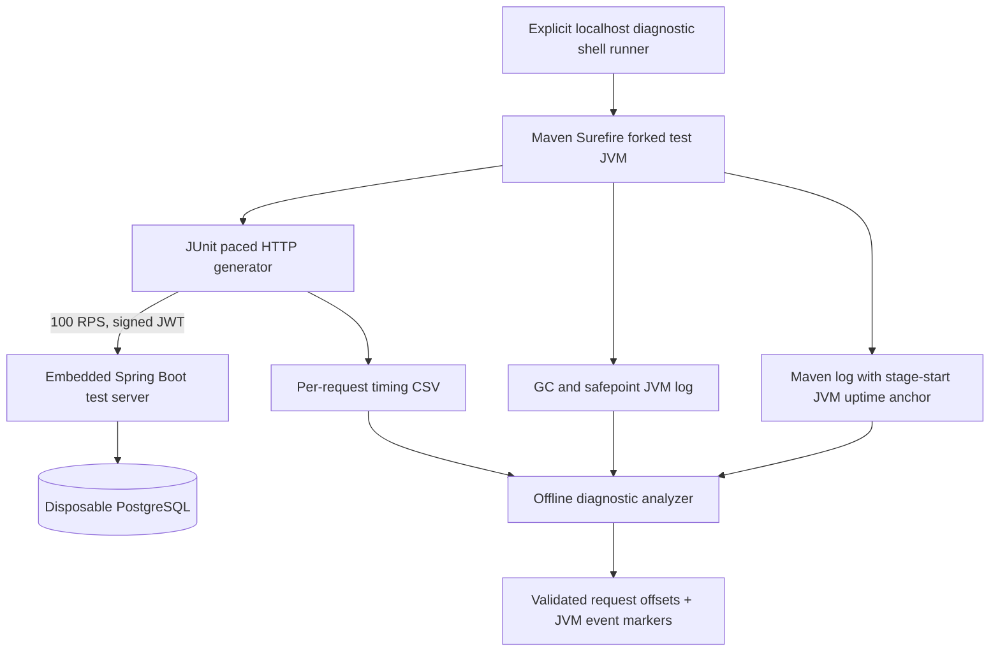

# Chapter 69 — Correlating Client Request Latency and JVM Events, From Zero

> **Milestone 22 — code implemented; no new diagnostic measurements yet.**
> Only synthetic payment data, signed test JWTs, the loopback
> Spring Boot server and disposable PostgreSQL 17 are used.
> The experiment is opt-in and stays at 100 RPS for 60 seconds.

## 1. Start with an everyday example

Imagine you are waiting for a parcel. The delivery company says it
was late. To understand why, you need the time it was dispatched,
when it reached the sorting center and whether the sorting center
experienced a delay. Knowing only *how late it was* does not reveal
which part of the journey caused the problem.

Our last experiment had seven clusters of slow HTTP requests.
All requests succeeded, but some took around 80–148 milliseconds.
We know their sequence IDs and *scheduled* order, not their
actual client start and completion offsets or JVM pause events.

This increment captures more of the timeline, without increasing
load or changing application business behavior.

## 2. Terms from the beginning

| Term | Simple meaning | Here |
| --- | --- | --- |
| Monotonic clock | A timer for elapsed durations that cannot jump when the wall clock is adjusted | `System.nanoTime()` |
| Offset | Time measured relative to a chosen start | Client start/end in milliseconds since load stage start |
| JVM uptime | How long a Java process has existed | Used to interpret `-Xlog` timestamps |
| GC | Garbage collection: Java reclaims unused objects | JVM logging records GC activity |
| Safepoint | A JVM coordination point, sometimes involving a pause | JVM unified logging supplies event markers |
| Correlation | Events occurred near one another in time | A clue, not proof of causation |
| Causation | A demonstrated reason an event occurred | Requires controlled diagnostic evidence |
| Test JVM | The Java process running JUnit and the embedded Spring test server | Instrumented with Java unified logging |
| CSV | Comma-separated rows of individual samples | 6000 measured HTTP samples |

## 3. What is the architecture?



This is a **single-process diagnostic lab**: the JUnit HTTP
client and the embedded Spring server run in the same forked
test JVM. A JVM-wide stop-the-world pause could affect
both client and server. The architecture therefore cannot
separate client-side and server-side JVM pauses on its own.

## 4. Exactly what changed?

### Step A — Preserve the existing workload

The test still creates 128 seeded payment records for each of
four simulated merchants (512 seed records total), then sends
6,000 measured HTTP requests: 4,800 reads and 1,200 writes.
The read/write mix and 70/10/10/10 merchant allocation remain
unchanged. Limits remain eight workers, at most 32 outstanding
requests and Hikari maximum four connections.

### Step B — Record actual *client* start and end offsets

Source:
`src/test/java/dev/asambataiden/payment/performance/MixedHttpWorkloadLab.java`

The `Sample` record now includes:

```java
double clientStartOffsetMs;
double clientEndOffsetMs;
```

The test captures `System.nanoTime()` immediately before and
after the blocking `HttpClient.send` call. These are **client**
measurements, not server entry/exit or SQL execution time.

Each value is converted to milliseconds relative to the
`start` monotonic timestamp set at the beginning of the
measured workload. This avoids relying on wall-clock times,
which may be adjusted by the operating system.

We retain the six columns previously collected and append:

```csv
client_start_offset_ms,client_end_offset_ms
```

The CSV still does **not** include merchant names,
bearer tokens, payment IDs, addresses or request bodies.

### Step C — Mark the test JVM's uptime

The test prints:

```text
MIXED_HTTP_LAB stage_start_jvm_uptime_ms=... timing_basis=monotonic_client_offsets
```

This uptime snapshot is taken near the measurement stage's
monotonic timestamp. JVM logging displays timestamps as
milliseconds since JVM startup. Subtracting the anchor from
a JVM log timestamp gives an **approximate** time position
relative to the HTTP workload stage.

It is not a perfect common timestamp: the clocks are sampled
sequentially, and different JVM event lines may represent
start, finish or another point in an event's lifecycle.

### Step D — Capture JVM events with unified logging

```text
-Xlog:gc*,safepoint:file=target/http-load-lab/RUN-correlated-jvm.log:uptimemillis,level,tags
```

- `-Xlog`: enables JVM unified logging.
- `gc*`: include garbage-collection tags.
- `safepoint`: include safepoint event logs.
- `file=...`: store a separate log, rather than flooding
  the Maven console with JVM events.
- `uptimemillis`: express log timestamps as JVM uptime in ms.
- `level,tags`: include severity and event classification.

The test is run from the repository root so the JVM log file
path is relative and contains no spaces; the user's Mac repo
path itself contains spaces. Maven Surefire uses JVM
arguments that are split on whitespace; quoting only the
outer Maven argument would not solve a path embedded in
`-Xlog`.

The project already has a Surefire configuration that retains
the configured `argLine`; the runner uses it for this
**specific opt-in test**, without modifying standard CI tests.

### Step E — Validate evidence offline

New file:
`ops/benchmarks/http/analyze-correlated-diagnostics.py`

This analyzer checks:
- exactly 6000 unique sequence values;
- correct GET/POST response codes;
- expected per-merchant read and write counts;
- finite, nonnegative client duration and start/end offsets;
- close agreement between measured duration and end minus start;
- exactly one stage-start JVM uptime anchor;
- JVM log entries carrying uptime, tags and GC/safepoint context.

It reports the first 40 requests over 50 ms in **actual
client-start-offset order**, and the first 60 matching JVM
logging lines with their approximate offsets from the stage
start. Those lines are bounded for readability.

A temporal match can suggest a hypothesis but cannot by
itself prove a JVM event caused delayed HTTP responses.
This tool does not use the network or execute payment code.

## 5. Hands-on macOS instructions

**Requirements:** Java 25, Maven, Python 3, Docker Desktop,
and the `feat/payment-ledger` checkout.

Discover the repository root:

```bash
ROOT="$(git rev-parse --show-toplevel)"
printf 'Repository: %s\n' "$ROOT"
```

Inspect your branch, then fast-forward:

```bash
git -C "$ROOT" status --short --branch
git -C "$ROOT" pull --ff-only origin feat/payment-ledger
```

Check shell and Python syntax before generating traffic:

```bash
bash -n "$ROOT/ops/benchmarks/http/run-correlated-diagnostics-local.sh"
python3 -m py_compile "$ROOT/ops/benchmarks/http/analyze-correlated-diagnostics.py"
```

Run **one** isolated stage:

```bash
bash "$ROOT/ops/benchmarks/http/run-correlated-diagnostics-local.sh"
```

The runner prints the actual files, all under
`target/http-load-lab/`:
- `*-correlated-maven.log`: Spring/JUnit/Maven output and stage uptime anchor
- `*-correlated-requests.csv`: 6000 request measurements with start/end offsets
- `*-correlated-jvm.log`: JVM GC and safepoint event records
- `*-correlated-analysis.log`: validated offline diagnostic report

The runner checks the CSV has exactly 6001 lines including
the header. If the test or the analyzer fails, preserve all
evidence instead of declaring a result.

## 6. Interpreting the results correctly

Suppose an HTTP request began at stage offset 31,660 ms and
ended at 31,800 ms. Its duration is roughly 140 ms.
Suppose a JVM pause marker appears at a similar offset.
That would make JVM pauses worth investigating.

However:
- The JVM log line might mark the *completion* of a pause.
- Client and server share the same JVM in this lab.
- The anchor is an approximate, sequentially sampled alignment.
- Scheduling delays can affect when measurements are recorded.
- GC allocation and pauses may be present even when they
  have no meaningful effect on the measured request.
- A missing GC line is not proof that the operating system
  did not pause a thread.

For a reliable diagnosis, examine event types and durations,
then compare controlled repetitions under matched conditions.

## 7. What we cannot yet claim

The new test has **not** been executed locally. We cannot
claim that the old seven slow clusters will recur.
We cannot claim a GC or safepoint caused them, nor rule out
PostgreSQL or host interference.

The diagnostic tool adds overhead to one test execution;
a future controlled comparison should consider observer
effects. This remains simulated payments, not a real
financial settlement system or a production capacity test.

## 8. Interview questions

**Why do you use `nanoTime()` rather than `currentTimeMillis()`
for HTTP duration?** A monotonic elapsed timer is not
subject to wall-clock adjustments.

**Why log JVM uptime?** It gives a compatible approximate
time origin for aligning JVM events with HTTP client offsets.

**Why record start and end offsets separately?** A duration
alone does not locate a slow request in the test timeline.

**What is an observer effect?** Instrumentation can change
the timing of the system being measured. We therefore keep
event logging bounded and CSV writing outside the measured
HTTP dispatch loop.

**Does a matching GC event prove cause?** No. We need
well-understood event boundaries, repeated evidence and
possibly a separate client process to isolate dependencies.

**Why not increase the DB pool now?** Previous Hikari snapshots
showed no waiting queue; we do not have evidence that
a connection shortage caused the observed delays.

## 9. Learning exercise

After running the opt-in diagnostic:
1. Identify the sample's **actual client start/end offsets**.
2. Explain how JVM uptime is turned into an approximate
   relative stage offset.
3. Compare the 20 slowest request offsets against relevant
   GC/safepoint event markers.
4. State which interpretations are direct observations,
   which are plausible and which remain unverified.

Do not fabricate a JVM root cause from a coincident log line.
