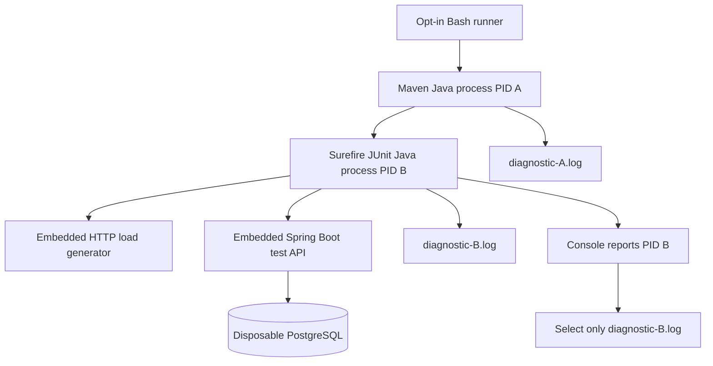

# Chapter 71 — Why JVM GC Logging Was Still Missing, and How to Identify the Correct Process

> **Milestone 22, second recovery increment.** The 2026-11-10 local rerun
> on commit `60be8564fb0ed53dedc458d47fab5f38db33c363`
> completed 6,000 synthetic HTTP requests successfully, but the runner
> could not find a GC/safepoint file for the forked test JVM.
> The underlying latency incident remains **unexplained**.

## 1. Start with a real-world example

Imagine asking two cameras to record an experiment: one camera
watches the experiment, while the other records the setup crew.
A recording from the setup crew is **not proof** that the
experiment camera worked.

Maven launches Java, and Maven Surefire normally starts **another
Java process** to run JUnit. Logging the wrong process tells us
nothing about the JVM hosting the Spring Boot application
and HTTP client we intend to study.

The earlier fix introduced an absolute path and a Java
preflight. This ensured the JVM option worked in *some*
Java process, but the test JVM still did not produce
the expected file. We must identify the **actual test PID**.

## 2. Exact observed results of the second attempt

The user's run showed:

| Evidence | Observed |
| --- | ---: |
| GET 200 | 4,800 |
| POST 201 | 1,200 |
| Unexpected HTTP statuses | 0 |
| Measured throughput | 100.01 RPS |
| GET p95/p99 | 4.362 / 5.653 ms |
| POST p95/p99 | 6.471 / 7.637 ms |
| Maximum client outstanding calls | 2 |
| Sampled pending Hikari acquisitions | 0 |
| Sampled PostgreSQL waits (max) | 0 |
| CSV exported | 6,000 rows |
| JVM uptime anchor | 4,815 ms |
| GC/safepoint file at expected path | **Missing** |

Maven returned `BUILD SUCCESS`, but the runner then reported
`Evidence failure: forked Surefire JVM did not create a nonempty
GC/safepoint log.`

**What this proves:** HTTP behavior passed the specified local
test gates; the separate JVM-evidence gate failed.
The earlier 30–40-second request slowdown was **not observed**
in the current ten-second summaries. It does not prove
the problem has been permanently resolved.

## 3. Maven JVM versus Surefire test JVM



The test records its own process identifier using:

```java
ProcessHandle.current().pid()
```

and prints:

```text
MIXED_HTTP_LAB test_jvm_pid=...
```

**Why this matters:** the runner can now unambiguously select
the JVM log filename for that exact PID. It must not accept a
`java -version` preflight log or the Maven JVM's log.

## 4. What changed in the runner

File:
`ops/benchmarks/http/run-correlated-diagnostics-local.sh`

The new runner supplies the Java unified-log option through
the standard environment variable `JAVA_TOOL_OPTIONS`:

```text
-Xlog:gc*,safepoint:file=/tmp/.../diagnostic-%p.log:uptimemillis,level,tags
```

`JAVA_TOOL_OPTIONS` is inherited by the Maven Java process
and its child Surefire Java process in normal JVM execution.
`%p` is expanded by the JVM logging system into the process
identifier, producing **different log files for different JVMs**.

The runner now:

1. Creates a unique, whitespace-free temporary directory.
2. Checks whether the JVM logging option is accepted with a
   `java -version` preflight.
3. Removes **all** preflight-created log files.
4. Starts one bounded 100-RPS / 60-second localhost workload
   with the environment-provided logging option.
5. Extracts the real test JVM PID from its own output.
6. Requires that exact process's log file to be nonempty.
7. Copies that file to the timestamped evidence directory.
8. Validates all 6,000 CSV request rows and invokes the offline
   JVM/client-timing analyzer.
9. Preserves any JVM logs for troubleshooting if the run fails.

This avoids dependence on Surefire `argLine` interpolation
and ambiguity about its working directory. The Java application
and normal non-opt-in CI configurations are unchanged.

## 5. What remains uncertain?

The user's shared console cannot prove why the original
Surefire JVM log was missing. Possible factors include
configuration precedence, fork argument handling or
path resolution. Changing to a JVM-inherited environment
option and matching PID is a more defensible diagnostic
design, but **the revised implementation remains
unverified until actually executed**.

A JVM log with a matching PID proves evidence was generated
by the intended process; it still **does not prove GC
caused a slow HTTP request**. We must study event types,
durations and their timing relative to actual client
request starts and finishes.

## 6. Safe practical exercise on macOS

No production payments, external hosts or cloud resources
are involved. Use Java 25, Maven, Python 3 and Docker Desktop:

```bash
ROOT="$(git rev-parse --show-toplevel)"
git -C "$ROOT" status --short --branch
git -C "$ROOT" pull --ff-only origin feat/payment-ledger

bash -n "$ROOT/ops/benchmarks/http/run-correlated-diagnostics-local.sh"
python3 -m py_compile "$ROOT/ops/benchmarks/http/analyze-correlated-diagnostics.py"

bash "$ROOT/ops/benchmarks/http/run-correlated-diagnostics-local.sh"
```

Expected evidence files under `target/http-load-lab/`:
- Maven/JUnit console log with `test_jvm_pid` and stage-uptime anchor
- 6,000-row request timing CSV
- GC/safepoint log from **the matching Surefire JVM PID**
- Offline timing analysis

**Do not claim success** from `BUILD SUCCESS` alone: the
runner must reach the final evidence-reporting line and
the analyzer must validate its inputs.

## 7. Senior engineering interview Q&A

**Why might a Maven test pass without a GC log?** A test
asserts application behavior. Producing a separate JVM event
artifact is an additional, independent requirement.

**Why was `JAVA_TOOL_OPTIONS` considered?** It supplies
a JVM startup option through the environment, avoiding
reliance on a Maven plugin's argument-property interpolation.

**Why use `%p` in the log filename?** Multiple JVMs are
started, and a unique PID suffix prevents one Java process's
log from overwriting another's.

**Why print `ProcessHandle.current().pid()` in JUnit?**
It binds a test observation to the actual executing JVM
rather than guessing from shell process IDs.

**Why isn't timing overlap proof of causation?** An event and
a slow response can coincide without one causing the
other. Additional control and event-interval interpretation
are necessary.

## 8. Status and next gate

- **Verified:** the HTTP stage in the prior run completed
  6,000 calls successfully.
- **Observed failure:** the earlier diagnostic evidence file
  was missing, twice with different path strategies.
- **Implemented:** JVM-inherited per-PID logging and
  explicit matching to the JUnit process.
- **Outstanding:** run locally and verify that the
  appropriate JVM log and offline correlation report exist.
