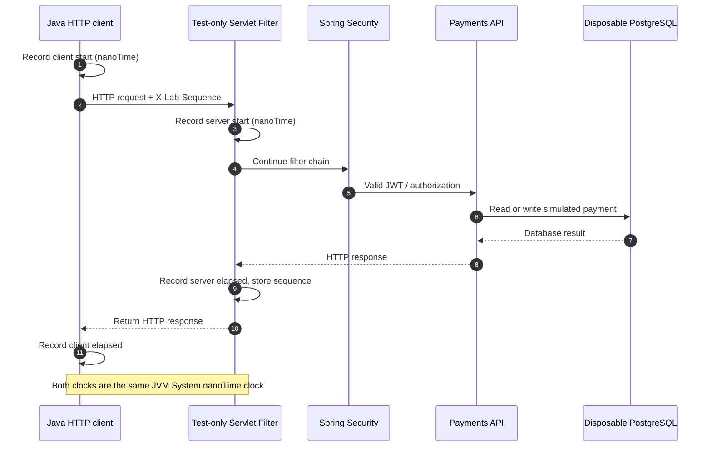

# Chapter 75 — Measuring HTTP Client and Server Time Separately, From Zero

> **Milestone 23: implementation and local evidence verified on November 10, 2026.**
> This is an educational **simulated payment** platform. The experiment
> uses a localhost Spring Boot HTTP server, Testcontainers PostgreSQL 17,
> signed synthetic JWTs, and one explicitly bounded workload.
> **Important limitation:** the client and application still run in
> the *same* Surefire JVM. Separate JVM/process isolation is a future step.

## 1. The problem in plain language

Last week we found one intermittent slowdown: seven short clusters
of slower requests in a 60-second test. In later trials the
slowdowns did not reappear, and routine JVM GC pauses stayed short.

We had the **client's view**: the time from requesting an HTTP
response to receiving it. But we did not know how much time the
application spent handling that request.

Think of a restaurant: the customer measures from placing an
order until receiving the food. The kitchen measures from
accepting the order until finishing its work. The difference
includes waiter transit, queues, handoff and other overhead.

Likewise, the client round trip includes work beyond the
server's in-process handling period.

## 2. Architecture and measurement boundaries



The new server-side timing measurement is test-only: a
`FilterRegistrationBean` registered in the JUnit test
configuration, ordered before Spring Security, and restricted
to the payment API paths.

The test sends an internal `X-Lab-Sequence` header containing
only an integer 1..6000. No tokens, merchant IDs, payment IDs,
or request bodies are exported as evidence. The filter
stores duration and server-start offset in a bounded,
in-memory concurrent map keyed by the synthetic sequence.

No timing headers are returned to application consumers.
This change does not modify the production application.

## 3. The CSV evidence contract

The previous eight columns remain, followed by two new ones:

```csv
sequence,merchant_index,operation,http_status,latency_ms,window_start_second,client_start_offset_ms,client_end_offset_ms,server_start_offset_ms,server_elapsed_ms
```

Definitions:

- `client_start_offset_ms`: actual client send-start relative
  to measured stage start.
- `client_end_offset_ms`: actual client send-completion offset.
- `server_start_offset_ms`: when the test-only servlet filter
  began handling the matching request.
- `server_elapsed_ms`: elapsed time inside the server filter
  through the downstream authentication, controller and
  persistence path.

All offsets use the **same monotonic clock** because the
client and server still share a JVM. This avoids clock
synchronization uncertainty *for this intermediate step*,
but also means a JVM-wide pause can affect both.

The test requires exactly **one server timing per
measured request** and rejects missing, duplicate or
nonfinite timing evidence.

## 4. What can we calculate?

```text
client_duration_ms = client_end_offset_ms - client_start_offset_ms
server_duration_ms = server_elapsed_ms
residual_ms = client_duration_ms - server_duration_ms
```

The residual is the portion **not measured inside the
server filter**. It may include HTTP client handling,
loopback transport, HTTP connection scheduling, servlet
container dispatching and instrumentation differences.
It is **not** an exact network latency measurement.

An occasionally negative residual is diagnostically
interesting, rather than proof of an impossible
request. For example, a response might be observable
by the client shortly before a server-side filter
finally-block completes. The analyzer reports how many
negative residuals occur, instead of hiding them.

We compute server p95 and residual p95 **separately**
for GET and POST. Percentiles of differences should
be calculated from each request's paired data, not
by subtracting the client and server p95 values.

## 5. No changes to the workload envelope

| Safety boundary | Fixed value |
| --- | ---: |
| Duration | 60 seconds |
| Offered traffic | 100 RPS |
| Measured calls | 6000 |
| GET / POST | 4800 / 1200 |
| Simulated merchants | 4 |
| Initial records per merchant | 128 |
| Worker threads | 8 |
| Maximum in-flight | 32 |
| Hikari maximum connections | 4 |
| HTTP destination | 127.0.0.1 only |
| Database | Disposable Testcontainers PostgreSQL |

These remain **bounds on an isolated local experiment**,
not production capacity or a service-level agreement.

## 6. Defensive evidence validation

The offline analyzer at
`ops/benchmarks/http/analyze-correlated-diagnostics.py`
accepts either:
- the **legacy eight-column format** from Milestone 22;
- the **new ten-column format** with server timing.

It validates 6,000 distinct sequence IDs, expected statuses,
GET/POST and tenant counts, finite and nonnegative durations,
and the server-start offset relative to the observed client
interval. It prints `CLIENT_VS_SERVER_TIMING` summaries,
without labeling the residual as pure networking time.

The standalone regression tests cover:
1. Matching a real-format padded G1 completion record.
2. Excluding GC-start and safepoint duplicates.
3. The known 12-pause regression fixture.
4. Legacy eight-column compatibility.
5. Accepting the new ten-column synthetic fixture.
6. Rejecting a negative server duration.

All six regression tests subsequently **passed on the developer's Mac**.

## 7. Practical macOS steps

Run from any folder inside the checkout. Docker Desktop
must be available for the bounded integration experiment.

First fetch the latest branch:

```bash
ROOT="$(git rev-parse --show-toplevel)"
git -C "$ROOT" status --short --branch
git -C "$ROOT" pull --ff-only origin feat/payment-ledger
```

Run the **fast offline regression tests first**:

```bash
python3 "$ROOT/ops/benchmarks/http/test_analyze_correlated_diagnostics.py"
bash -n "$ROOT/ops/benchmarks/http/run-correlated-diagnostics-local.sh"
```

Only then run **one** new isolated test:

```bash
bash "$ROOT/ops/benchmarks/http/run-correlated-diagnostics-local.sh"
```

The runner records request CSV, JVM/safepoint log,
Maven log and offline analysis in
`target/http-load-lab/`. The output should contain
`CLIENT_VS_SERVER_TIMING` with per-operation server
and residual metrics. The runner fails if an evidence
gate is violated.

If Java compilation, integration assertions or
Python validation fails, **preserve the log and
report the real failure**. Do not modify the application
or silently lower assertion thresholds to force a pass.

## 8. What is not yet achieved?

This is **not** an independent client process:
the HTTP load generator remains inside the JVM that
hosts the Spring application. This design offers
measured interval separation, but not process
isolation, independent JVM GC behavior or
independent host CPU scheduling.

That is an explicit next-stage architectural goal,
which should be undertaken only after this narrower
increment passes its correctness and evidence gates.

The local bounded run subsequently passed, but the transient latency
incident from the earlier experiment remains unexplained. A healthy
60-second run does not, by itself, explain why the anomaly occurred once.

## 9. Interview questions

**Why is a server filter useful?** It measures a bounded
part of request handling and avoids guessing from
end-to-end latency alone.

**Why must it be test-only?** In an ordinary application,
extra per-request instrumentation and synthetic headers
could introduce overhead and new attack surface.
This lab does not change the production deployment.

**Why correlate by sequence ID?** A sequence provides
unambiguous pairing without exporting payment
identifiers or credentials.

**Why is client p95 minus server p95 invalid?**
They come from potentially different request samples.
Compute each request's residual, then calculate
the residual percentile.

**Why can't we call the residual network latency?**
The measurement also contains HTTP client work,
server dispatch and other overhead.

**Why isn't same-JVM measurement enough to fully
isolate the cause?** A stop-the-world JVM pause
affects both the test client and server. A future
separate-client JVM experiment would remove
that shared runtime as a confounding factor.

## 10. Actual verified local result — November 10, 2026

The developer ran the opt-in experiment at implementation commit
`f49bc1b4e772c36013fe98ffccd5828d6091997f` on their Mac,
starting at 12:21:17 UTC. The runner produced Maven, CSV, JVM,
and offline analysis logs under `target/http-load-lab/`.

**Independent evidence gates:** all six Python regression tests passed;
Maven reported one passing integration test and `BUILD SUCCESS`;
all 6,000 rows were validated (4,800 GET, 1,200 POST); there were
zero HTTP status errors and zero negative paired residuals.

| Verified synthetic workload metric | GET | POST |
| --- | ---: | ---: |
| Measured calls | 4,800 | 1,200 |
| Client p95 (ms) | 4.277 | 6.604 |
| Client p99 (ms) | 5.334 | 7.896 |
| Server p95 (ms) | 3.551 | 5.953 |
| Residual p95 (ms) | 0.849 | 0.789 |
| Server maximum (ms) | 16.846 | 14.638 |

The measured throughput was **100.01 RPS** over **59.994 s**.
The 250-ms Hikari/DB snapshots had zero pending connections,
zero observed DB waits and maximum one active connection.
Maximum in-flight client requests was two; max scheduling lag
was **2.541 ms**. These sampling results cannot rule out
shorter-than-sample-interval waiting events.

The PID-matched JVM evidence contained **105** matching
GC/safepoint log lines: **69 startup, 36 measured, 0 post-stage**.
Twelve measured G1 pause-completion records ranged from **2.877** to
**4.635 ms**, with sum **47.572 ms**. The analyzer reported
`slow_requests_over50ms=0`.

**CI for the exact tested commit:**
[Java CI passed](https://github.com/asambataiden/enterprise-payment-platform/actions/runs/42814697597)
and [Security CI passed](https://github.com/asambataiden/enterprise-payment-platform/actions/runs/42814697825).
These standard CI workflows are distinct from the opt-in Mac
performance test.

### Verified limits

The new `server_elapsed_ms` includes a test-only servlet-filter
interval, not a separately instrumented full application lifetime.
The residual is not a standalone measurement of network latency.
Both endpoints remain in the same Surefire JVM; this is an
**instrumentation milestone**, not yet independent-process isolation.
The earlier one-off 30–40-s latency incident is still unexplained.
