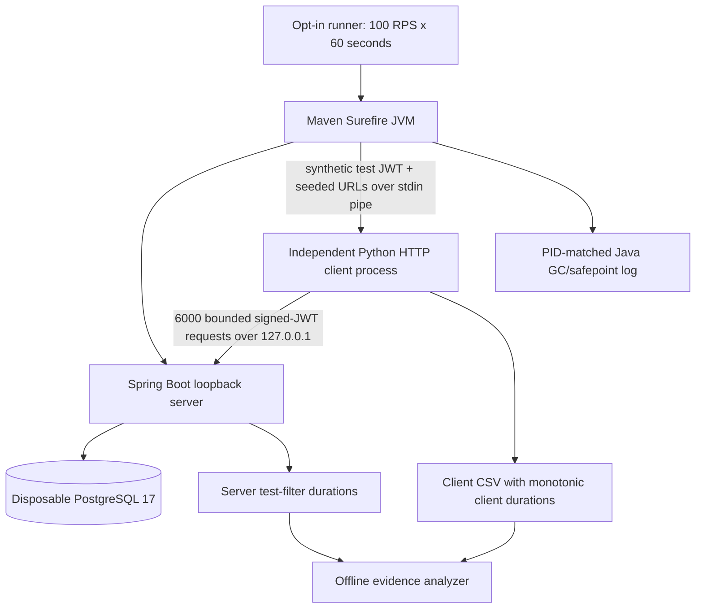

# Chapter 76 — A Real Separate HTTP Client Process (Milestone 24)

> **Status: implemented on `feat/payment-ledger`; NOT yet executed locally.**
> Educational synthetic payments only. This experiment needs Python 3,
> Maven, Java 25 and Docker Desktop on macOS. It does not target real
> payment providers, external networks or production databases.

## 1. The problem in plain language

Previous experiments ran both the HTTP load generator and the Spring
server in the SAME Surefire Java process. A JVM-wide pause could
affect both sides, making latency attribution ambiguous.

Milestone 23 added a server-side request duration so we could compare
client round trips with server processing. But the clock and runtime
were still shared.

Milestone 24 moves the HTTP load generator into its own **Python
process**, while JUnit and the Spring server remain inside the
**Surefire Java process**. Both run on the same physical Mac and
connect via `127.0.0.1`, so host interference is still possible.

## 2. The architecture and each component



The JUnit test owns the disposable database and all synthetic
merchant fixtures. It launches the Python client with
`ProcessBuilder` and hands it exactly four synthetic JWTs
and 128 pre-created GET URLs per merchant **through stdin**.
These values are not placed in command-line arguments, environment
variables or CSV files. The child process reads them once,
does not print them, and exits after the bounded workload.

**No production source files are changed.** The timing servlet
filter remains restricted to test configuration and simulated
payment API paths.

## 3. Two monotonic clocks: do not subtract offsets

The Python process uses `time.perf_counter_ns()`.
The Java server uses `System.nanoTime()`.

Those clocks have independent reference origins and are
**not asserted to be aligned**. It is invalid to subtract
the Python `client_start_offset_ms` from Java
`server_start_offset_ms`.

Instead, each request is correlated using the test-only
`X-Lab-Sequence` integer:

```text
client_csv: sequence, merchant, operation, HTTP status, client duration, client offsets
server_csv: sequence, server start offset, server duration
joined by:   sequence
derived:     client_duration - server_duration (paired elapsed intervals)
```

The paired **duration residual** includes client internals,
loopback communication and server dispatch outside the timing
filter, among other possible effects; it is not a pure
network latency measurement.

Only the **durations**, not the cross-process absolute
offsets, are directly compared.

## 4. Exact bounded synthetic workload

| Property | Value |
| --- | --- |
| Duration | 60 seconds |
| Intended dispatch rate | 100 requests/second |
| Total requests | 6000 maximum |
| Requests | 4800 GET + 1200 POST |
| Merchants | Four synthetic merchants |
| Distribution | 70% / 10% / 10% / 10% per operation |
| Seeded records | 128 per merchant |
| Python worker pool | Eight |
| Maximum outstanding calls | 32 |
| Timeout per request | Five seconds |
| Server | 127.0.0.1 on ephemeral port |
| Database | Testcontainers PostgreSQL 17 |
| Server Hikari maximum | Four connections |

The Python client uses standard-library `urllib.request`
and intentionally has different HTTP client behavior than
the earlier Java `HttpClient`. Its latency distribution
is **not directly interchangeable** with earlier Java-client
measurements. Do not claim a performance gain or regression
without controlling for client implementation.

The independent client refuses non-loopback URLs, redirects
and environment-configured HTTP proxies to avoid leaking
synthetic bearer tokens outside the lab.

## 5. Implementation files and responsibilities

- `src/test/java/dev/asambataiden/payment/performance/MixedHttpWorkloadLab.java`:
  retains the old shared-JVM experiment but skips it when the
  explicit independent-mode property is enabled; seeds the
  disposable database, launches and supervises the child,
  verifies exactly one server observation for every sequence,
  and writes test-only server evidence.
- `ops/benchmarks/http/independent-client-local.py`:
  reads fixtures over stdin, strictly confines requests to
  loopback, runs one 100-RPS schedule, validates HTTP status
  and writes **credential-free client evidence**.
- `ops/benchmarks/http/analyze-independent-process.py`:
  validates the two files, cross-checks sequence IDs, tenant
  distribution and statuses, and computes GET/POST client,
  server and paired residual p95 values.
- `ops/benchmarks/http/test_independent_process.py`:
  fast no-network tests for deterministic tenant allocation,
  loopback validation, independent clock domains and missing
  server sequence rejection.
- `ops/benchmarks/http/run-independent-process-local.sh`:
  single opt-in runner and artifact integrity gate, plus
  PID-matched server JVM GC/safepoint evidence.

## 6. Safety and correctness

Before HTTP work, the runner validates syntax with Python compilation
and executes the fast offline contract tests. The process orchestration
requires:
- an explicit opt-in JVM system property;
- the exact 100-RPS, 60-second, 128-record profile;
- bounded work queue and five-second HTTP timeout;
- one process with a 90-second upper wait before forced shutdown;
- correctly paired 6000-row client/server CSV evidence;
- PID-matched JVM logging and an offline analyzer success report.

If any gate fails, the experiment **must not** be reported as a
passed benchmark. Inspect the Maven and child logs before changing
configuration.

## 7. Commands to execute on macOS

```bash
ROOT="$(git rev-parse --show-toplevel)"
git -C "$ROOT" status --short --branch
git -C "$ROOT" pull --ff-only origin feat/payment-ledger

python3 "$ROOT/ops/benchmarks/http/test_independent_process.py"
bash -n "$ROOT/ops/benchmarks/http/run-independent-process-local.sh"

# Explicit opt-in: performs exactly one bounded synthetic local experiment.
bash "$ROOT/ops/benchmarks/http/run-independent-process-local.sh"
```

Results are written under `target/http-load-lab/` and include:
Maven log, independent Python client log, independent client CSV,
server timing CSV, PID-matched Java GC/safepoint log, and
a combined offline evidence analysis report.

Expected console anchors include:

```text
INDEPENDENT_CLIENT rows=6000 ...
INDEPENDENT_LAB ... server_samples=6000
INDEPENDENT_EVIDENCE VALIDATED rows=6000 ... clock_domains=independent
operation=GET count=4800 ...
operation=POST count=1200 ...
BUILD SUCCESS
```

**Do not pre-fill actual latency values.** The independent
process benchmark has not yet been executed on the developer's Mac.

## 8. What cannot be concluded

A separate client process prevents the client from sharing
the Java heap and Java GC pauses with the server. It does NOT
eliminate macOS scheduler, CPU, container runtime, filesystem
or local networking interference.

The original 30–40s latency bursts were observed in a
different run before timestamped JVM events were captured.
Nothing in this new design retroactively identifies their cause.

The server GC log and server timing CSV have different
clock origins, but both refer to the server JVM and can be
interpreted with the logged server-stage uptime anchor.
The Python client offsets should only be used *within*
the client process timeline.

## 9. Senior Java/DevSecOps interview questions

**Why isolate the client process?** It removes client load-generator
allocation and GC from the server's JVM and yields a more reliable
server-side runtime profile.

**Why Python, not a second Java JVM?** This first process-isolation
stage uses a small, dependency-free Python generator and avoids
sharing JVM behavior. The transport/client implementation changes,
so comparisons need that limitation stated explicitly.

**Why send JWTs over stdin?** Command-line arguments can be
visible in process inspection, and environment variables
are widely inherited; an ephemeral process pipe reduces
unnecessary exposure.

**Why use separate CSV files?** The client and server have
different monotonic clock origins. Mixing offsets into one
file would encourage incorrect timestamp subtraction.

**Why join by integer request sequence instead of payment ID?**
It is deterministic synthetic correlation without exposing
identifiers of business entities.

**If the new run has no slow requests, have we fixed the old
incident?** No. Intermittent behavior requires repeatable,
time-correlated evidence and controlled experiments.
