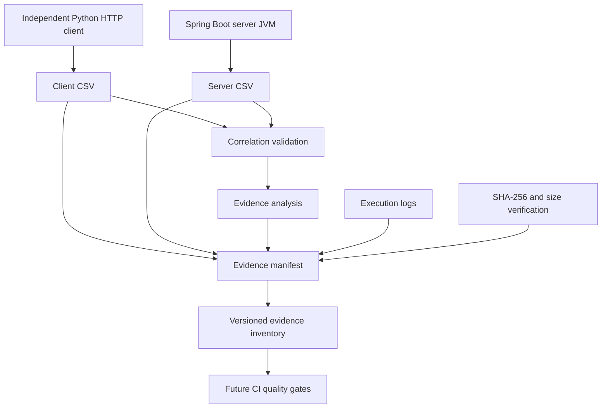

# 77 — Performance Evidence Governance From Zero

## Learning objectives

Understand how to preserve, validate, and audit performance
benchmark artifacts using deterministic manifests, SHA-256
digests, automated tests, and reproducible verification.

## 1. Problem statement

A successful performance benchmark is not sufficient
evidence by itself.

Benchmark results can be:
- Accidentally modified or truncated
- Separated from their execution metadata
- Mixed with artifacts from another run
- Incorrectly interpreted
- Published without an integrity check

Our objective is to establish a verifiable relationship
between a benchmark execution and its resulting artifacts.

## 2. Architecture



The diagram describes logical evidence processing.
An evidence manifest does not establish request correctness
without the separate correlation validation.

## 3. Implementation components

### Independent workload

`independent-client-local.py`

Runs the synthetic HTTP workload outside the application
JVM and records client-side timings.

### Request-level correlation

`analyze-independent-process.py`

Validates the client/server sequence identifiers,
expected request distributions, and measured durations.

Monotonic clock offsets from different processes must
never be directly subtracted.

### Evidence manifest

`evidence-manifest.py`

Creates a JSON manifest containing:

- Schema version
- Benchmark identity
- Run identifier
- Declared Git commit
- Declared workload configuration
- Process and clock-domain metadata
- Artifact names
- Artifact byte sizes
- Artifact SHA-256 digests

The manifest uses relative artifact names to avoid
embedding workstation-specific absolute paths.

### Governance tests

`test_evidence_manifest.py`

Exercises successful creation and verification,
deterministic serialization, malformed metadata,
missing artifacts, corruption, duplicate entries,
invalid names, symlink substitution, and overwrite
protection.

## 4. Why SHA-256?

SHA-256 is a cryptographic hash function producing a
256-bit digest.

Changing artifact content should change its digest,
making accidental or unauthorized modifications
detectable when compared against a trusted digest.

Hash verification provides content integrity.

It does not independently prove artifact authenticity,
execution correctness, or trustworthy provenance.

An attacker able to replace both evidence and its
manifest could produce a matching replacement.

## 5. Validation contract

The benchmark currently expects:

| Property | Value |
|---|---|
| Target rate | 100 requests/second |
| Duration | 60 seconds |
| Expected requests | 6,000 |
| Merchants | 4 |
| Read/write distribution | 80% GET / 20% POST |
| Evidence artifacts | 6 |
| Schema version | 1.0.0 |

The evidence manifest is intentionally specific to
this independent-process benchmark contract.

A future parameterized benchmark will require an
explicit schema and validation-contract revision.

## 6. Verification commands

From the repository root:

```bash
python3 ops/benchmarks/http/test_evidence_manifest.py

python3 ops/benchmarks/http/test_independent_process.py

python3 ops/benchmarks/http/test_analyze_correlated_diagnostics.py
```

For an existing run:

```bash
RUN_ID="20261110T192732Z-27136"

python3 ops/benchmarks/http/evidence-manifest.py verify \
  "target/http-load-lab/$RUN_ID-evidence-manifest.json"
```

Request-level correlation must also be independently
validated using the associated client/server CSV files.

## 7. Security considerations

- Do not place credentials or JWTs in manifests.
- Keep synthetic and production datasets separate.
- Do not automatically publish raw logs.
- Treat evidence files as untrusted input.
- Prevent path traversal and symlink substitution.
- Avoid overwriting an existing manifest.
- Store trusted evidence outside the build workspace
  when long-term authenticity is required.
- Consider signed attestations and trusted CI identities
  in later milestones.

A SHA-256 manifest is not a digital signature.

## 8. Reproducibility versus determinism

Deterministic serialization means identical inputs
generate identical manifest bytes.

Reproducible performance means repeated experiments
under appropriately controlled environments yield
comparable measurements.

These are different guarantees.

Performance comparisons require environment metadata,
multiple runs, statistical analysis, and baseline policy.

## 9. Current limitations

- Git provenance is supplied, not independently attested.
- The manifest does not verify the recorded workload
  parameters against Maven execution logs.
- Manifest verification does not rerun correlation analysis.
- Existing artifacts are not externally signed.
- The current implementation is locally tested and has
  not yet been integrated into CI.
- The manifest verifies integrity at the time of checking;
  it does not establish tamper-proof storage.

## 10. Interview questions

**Q: Why use an evidence manifest?**

A: To create a machine-readable inventory linking
benchmark artifacts with their declared execution
metadata, sizes, and cryptographic digests.

**Q: Does a SHA-256 digest prove who executed a benchmark?**

A: No. It establishes a content fingerprint.
Authenticity requires a trusted provenance mechanism.

**Q: Why keep the manifest validator separate from
the HTTP load generator?**

A: Separation of concerns allows evidence to be
validated without executing another load test.

**Q: Why is a single benchmark insufficient for
a regression quality gate?**

A: Performance is affected by environmental variability,
runtime warmup, operating-system scheduling, resource
contention, and statistical sampling.

**Q: Why must client and server clock offsets
not be subtracted?**

A: Their monotonic clocks have independent origins.
Paired durations can be analyzed, but offsets are
not directly comparable without synchronization.

## 11. Next milestones

Milestone 25.3:
- Integrate manifest generation and verification.
- Preserve meaningful process exit codes.
- Add secure CI artifact handling.
- Record additional execution provenance.

Milestone 26:
- Establish multi-run performance baselines.
- Analyze p50, p95, p99, errors, and throughput.
- Define justified performance regression thresholds.
