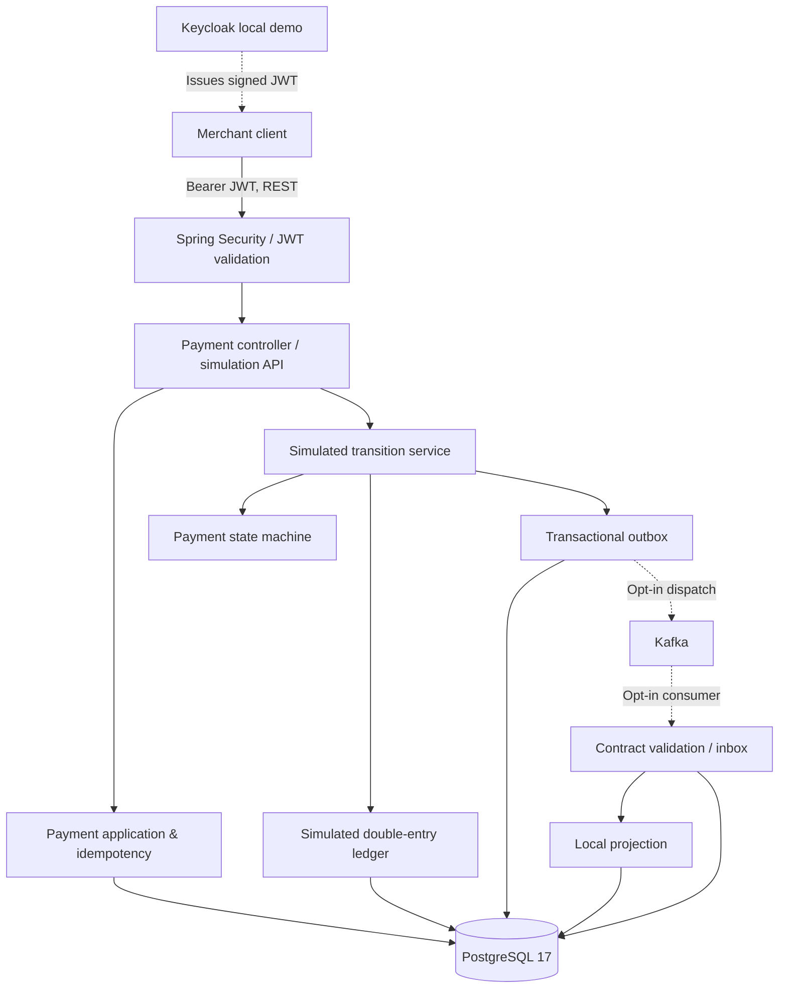

# Enterprise Payment Platform — Technical Case Study (v0.1.0)

> **Portfolio case study · Java Backend · Distributed Systems · DevSecOps**  
> Educational simulated payment processing only. **No real funds are moved.** This release is not production-ready, integrated with a regulated payment processor, or certified for financial compliance.

| Reference | Evidence |
| --- | --- |
| [Repository](https://github.com/asambataiden/enterprise-payment-platform) | Version-controlled implementation and documentation |
| [Release v0.1.0](https://github.com/asambataiden/enterprise-payment-platform/releases/tag/v0.1.0) | Published 10 November 2026 |
| Release source SHA | `39ad939a7a43ba7ade370334fa18fe04cf06c916` |
| [Java CI](https://github.com/asambataiden/enterprise-payment-platform/actions/runs/42919187324) | **Passed** at the release SHA |
| [Security CI](https://github.com/asambataiden/enterprise-payment-platform/actions/runs/42919187035) | **Passed** at the release SHA |

## 1. The engineering problem

A payment-like system must handle concurrent client retries, invalid state transitions, partial failures, durable event publication, duplicate delivery and tenant isolation. A successful HTTP response or Kafka broker acknowledgement is not equivalent to payment settlement.

The goal was to construct a reproducible **educational simulation** in which these risks can be implemented, observed and tested—without integrating financial networks or claiming actual settlement.

## 2. Technology and architecture

**Java 25 · Spring Boot 4.1.2 · Spring Security OAuth2 Resource Server · PostgreSQL 17 · Flyway · Kafka · Keycloak (local demo) · Maven · JUnit · Testcontainers · ArchUnit · GitHub Actions · Trivy · Gitleaks.**

The code is a **single-deployable modular monolith**, not a fleet of microservices and not a fully hexagonal architecture. Payment storage and event delivery expose selected ports/adapters, while some transaction orchestration still uses `JdbcTemplate` directly. This choice preserves local transactional consistency while the domain evolves.

**Boundary:** the successful local signed-JWT HTTP demonstration runs **with Kafka disabled**. Kafka broker and secured transport scenarios have separate automated/laboratory verification; the diagram is a logical view, **not** proof of a production end-to-end deployment.

### Main module responsibilities

| Area | Responsibility |
| --- | --- |
| `payments.api` | HTTP contracts, status codes, merchant reads/search/history, conditional simulation endpoint |
| `payments.application` / `payments.domain` | Business orchestration, payment state policy, idempotency |
| `ledger.domain` / `ledger.application` | Balanced immutable journal model and simulated posting |
| `payments.outbox` | Durable claims, lease fencing, retries, inbox deduplication |
| `payments.messaging.kafka` | Opt-in publisher, consumer, contract checks and security preflight |
| `shared.security` | Stateless JWT resource-server authorization |
| Flyway V1–V9 | Constraints, transactional data structures, outbox/inbox and search indexes |

## 3. Decisions and tradeoffs

### Concurrent idempotency — make PostgreSQL arbitrate

A read-then-insert check is race-prone when simultaneous requests use the same key. The intake path uses a merchant-scoped idempotency identity and atomic PostgreSQL insertion/uniqueness, with payload/retry validation. **Tradeoff:** database-backed idempotency is reliable only alongside correct business request comparison and consistent error handling.

### Explicit lifecycle — lock the owned payment

The simulated success path is **RECEIVED → AUTHORIZED → CAPTURED → REFUNDED**. FAILED and CANCELLED are terminal alternatives before capture. The transition service selects the merchant-owned payment `FOR UPDATE`, rejects invalid transitions, and treats repeats of the *same* event/payment/target as idempotent. Reusing an event ID for a different transition is rejected.

The payment state update, optional journal and outbox row are committed together under one PostgreSQL transaction. **Tradeoff:** this simplifies strong local consistency but cannot atomically commit Kafka broker state.

### Append-only double-entry journals — preserve reversal history

Capture creates balanced debit/credit postings based on **persisted** payment amount and currency, not client-provided account identifiers. A full refund writes a **compensating** journal instead of removing the original capture.

Flyway V3 provides ownership FKs, event uniqueness, deferred balance checks at commit, finalization controls and mutation rejection. **Tradeoff:** the simulated account model is intentionally simplified; production charts of accounts, partial refunds, FX, chargebacks, settlement and reconciliation are not provided.

### Transactional outbox — accept at-least-once attempts

The dispatcher claims pending rows with `FOR UPDATE SKIP LOCKED`, records a lease token, publishes outside the claim transaction and acknowledges delivery only when fencing matches. Failure paths use bounded backoff and poison-event quarantine.

A crash after Kafka accepted an event but before database ACK can cause a replay. **Do not claim exactly-once delivery.** The consumer's inbox transaction protects against duplicate **local** effects; remote services would require their own authenticated contract and deduplication.

### Fail-closed event consumption — avoid silent skips

The opt-in Kafka consumer rejects invalid event contracts, disables automatic offset commits, uses manual acknowledgement after a successful local transaction, and stops on processing failure rather than silently moving past a poison record. Redacted failure observations support diagnostics. **Tradeoff:** operator intervention may be needed to restore processing; no automated universal recovery guarantee is claimed.

### Modular monolith — defer distributed deployment costs

One deployable JAR keeps initial correctness and testability tractable. Architecture tests guard selected package boundaries. **Tradeoff:** packages are not separate deployable ownership units and some adapters remain directly coupled to JDBC.

## 4. Security boundaries

- **JWT:** Spring Security validates signed bearer tokens using configured issuer/audience; route policy distinguishes `payments:read`, `payments:write`, and `payments:simulate`.
- **Tenant isolation:** merchant identity is derived from the *validated* JWT `merchant_id` claim, not a user-controlled request field. Queries and ownership FKs scope persisted resources.
- **Simulation:** transition endpoint is absent unless `PAYMENT_SIMULATION_ENABLED=true`; permission and merchant ownership remain required.
- **Kafka:** application activation requires encrypted `SSL` / `SASL_SSL`, retains broker hostname verification and enforces producer `acks=all`. Test-only PLAINTEXT brokers are not deployed transport defaults.
- **Development identity:** declarative `ops/demo/keycloak/payments-realm.json` creates a **local** confidential service account with a hardcoded demo merchant identity. This is not a production identity governance design.
- **Diagnostics:** structured ECS logging, correlation IDs, bounded error contracts, low-cardinality metrics and guarded optional monitoring/OpenAPI endpoints.
- **CI:** packaged-application Trivy scan and Gitleaks Git-history secret scan passed. Neither constitutes a complete vulnerability assessment.

## 5. Verification — what was actually proven

| Evidence | Verifies | Does **not** verify |
| --- | --- | --- |
| [Final Java CI](https://github.com/asambataiden/enterprise-payment-platform/actions/runs/42919187324) | Maven `clean verify` regression plus Python benchmark-evidence contract checks passed on release SHA | Real payment processor, production throughput or production deployment |
| [Final Security CI](https://github.com/asambataiden/enterprise-payment-platform/actions/runs/42919187035) | Packaged application Trivy and full-history Gitleaks jobs passed | Exhaustive security assessment |
| [Lifecycle acceptance test](../../src/test/java/dev/asambataiden/payment/payments/application/SimulatedPaymentLifecycleAcceptanceIT.java) | Create/retry → authorize → capture → refund, two compensating journals, three outbox events, local inbox/projection and duplicate suppression, with PostgreSQL Testcontainers | Kafka network hop (publisher is in-process in this test) |
| [Kafka integration tests](../../src/test/java/dev/asambataiden/payment/payments/messaging/kafka/producer/KafkaOutboxEndToEndIT.java) | Real Kafka Testcontainers publish/consume with PostgreSQL outbox semantics | Production Kafka cluster |
| [Authenticated local smoke test](../../ops/demo/local-payment-smoke.py) | Signed Keycloak JWT, issuer/audience/merchant/scopes, HTTP 201 and RECEIVED → AUTHORIZED → CAPTURED → REFUNDED, final state/history | Kafka dispatch and independently queried ledger balances |
| [Local security lab](../../ops/monitoring/kafka-security-lab/) | Opt-in isolated mTLS / ACL exercises with disposable credentials | Organization production identities or hardened deployment |

**Observed live HTTP demo result:** a EUR 22.50 simulated payment was created with HTTP 201 and advanced through AUTHORIZED, CAPTURED and REFUNDED; three committed history events were verified. The demonstration has a local Keycloak admin-CLI authentication prerequisite. Do not print client secrets or bearer tokens.

**Benchmark evidence:** local synthetic performance studies appear in the learning chapters; they are scoped to specific test environments and commits. Report measured numbers only with those exact conditions, never as production SLOs. Some latency hypotheses remain unresolved.

## 6. Failure modes to explain in interviews

1. **Retry after timeout:** original payment may already exist; merchant-scoped idempotency should return the same logical result without duplicating intake.
2. **Two concurrent state changes:** row locking and explicit transition policy serialize/reject conflicting operations.
3. **Ledger insertion fails:** payment status and outbox must roll back with the same database transaction.
4. **Kafka publish succeeded but ACK persistence failed:** event can be delivered again; inbox dedup protects local effects.
5. **Consumer processing fails before offset acknowledgement:** fail-stop policy avoids falsely acknowledging a failed business action; restart/replay requires operational review.
6. **Forged merchant reference or event:** authenticated merchant scoping and committed-outbox provenance checks protect the local trust boundary; they do not prove remote producer authenticity.

## 7. Production-readiness limitations

This is **not** a production payment service. Missing real-world elements include payment-service-provider authorization and settlement, complete financial/accounting governance, certified compliance controls, production identity/secret management, independently authenticated cross-service provenance, operational recovery objectives, target-environment TLS/ACL validation, scale/load capacity qualification and full monitoring/on-call runbooks.

Some early ADRs and chapters preserve **historical incremental states**; current behavior should be checked against the release-tagged code and tests rather than assuming every historical “not implemented” note is current.

## 8. Interview questions — concise defensible answers

**Why not microservices?** A modular monolith preserves a consistent transactional boundary and makes correctness easier to validate before introducing network and ownership complexity.

**Why an outbox?** Payment state and delivery intent can commit atomically in PostgreSQL even though the subsequent Kafka publish cannot share that transaction.

**Does Kafka idempotence give exactly-once business effects?** No. Producer idempotence and broker ACKs do not make the database, consumer and remote effects one atomic transaction; the inbox protects local replays.

**How does refund work?** A full simulated refund creates a compensating balanced journal; the prior capture journal remains immutable.

**Where are permissions enforced?** Spring Security requires JWT scope, and the application derives merchant identity from a verified claim and checks ownership at its persistence boundary.

**How does recovery differ from ignoring failures?** The consumer is designed not to acknowledge failed processing; quarantine/observations and operator-directed recovery preserve evidence rather than silently skipping messages.

**What does green CI mean?** Named verification suites passed on a particular commit; it is not proof of production security or regulated financial correctness.

**What would you do before real deployment?** Define financial and external-provider requirements, implement identity and privileged access governance, establish cross-service trust, validate production TLS/ACLs, and exercise disaster-recovery, security and capacity controls.

## 9. Further reading in the released repository

- [Quick start and verified capabilities](../../README.md)
- [Architecture and module overview](../architecture/system-overview.md) *(includes early-milestone diagrams)*
- [Runtime scenarios](../architecture/runtime-scenarios.md)
- [Outbox delivery contract](../architecture/outbox-delivery-contract.md)
- [Kafka contract](../architecture/kafka-integration-contract.md)
- [Ledger ADR](../adr/0003-simulated-ledger-and-payment-state-machine.md) *(historical decision chronology)*
- [Full learning / interview handbook](../learning/README.md)
- [Execution evidence runbook](../learning/35-execution-evidence-and-retrospective-runbook.md)

**Portfolio claim:** A reproducible and tested Java-based simulated payment system demonstrating transactional consistency, merchant-scoped security, asynchronous messaging reliability and explicit engineering tradeoffs—not a production financial platform.
