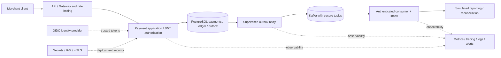

# Capstone roadmap — from first principles to enterprise-grade simulated payment systems

**Last reconstructed:** 2026-11-09. **Status legend:** ✅ implemented and tested in a known baseline; 🟡 partial/internal-only; ⬜ planned (not implemented). Status pertains to the **educational platform**, not real payment or compliance readiness.

## 0. Business problem and product vision

A merchant sends a payment-intake request and needs to know **whether it was recorded once**, **which merchant owns it**, and eventually **what simulated state it reached**. The backend must withstand retries, concurrent requests, failures, invalid messages and access attempts from another merchant.

**Business actors:** merchant application, authorized support/operations (future), identity provider (deployment integration not yet proven), simulated event source (internal only), external Kafka broker (optional publishing path), downstream subscriber (future).

**Core use cases:** UC-01 create payment with repeat-safe key; UC-02 retrieve only your payment; UC-03 simulate allowed state transition; UC-04 record balanced capture journal; UC-05 publish committed event; UC-06 consume event idempotently (local helper now, live Kafka consumer future); UC-07 inspect/replay failed delivery (operator workflow future).

**Non-goals:** accepting cardholder data, storing PAN, executing charges, settlement, safeguarding, real refunds, PCI-DSS certification, real banking integration.

**Quality drivers in priority order:** tenant isolation and authorization; financial-data integrity (simulation); concurrency safety; recoverability; maintainability and auditability; operability; reproducible learning and interview evidence.

## 1. Incremental history and why the order matters

| Increment | Capability and architectural reason | Implemented evidence | Status |
| --- | --- | --- | --- |
| 00 | Define a narrow, testable educational system before introducing infrastructure complexity | modular-monolith ADR, README, repository | ✅ baseline |
| 01 | Build a minimal Java/Spring Boot HTTP app and Maven verification path: find fast feedback early | `PaymentController`, application bootstrap, CI | ✅ |
| 02 | Persist `RECEIVED` records; use exact decimal amounts and schema migrations rather than ephemeral memory | `PaymentService`, `PaymentStore`, V1 payments | ✅ |
| 03 | Guarantee safe retries under parallel requests. Application-level “check then insert” alone races; use DB uniqueness and atomic insert | `PaymentJdbcWriter`, composite idempotency key, concurrency IT | ✅ |
| 04 | Add authentication, scoped routes and merchant-derived ownership before exposing more data | `PaymentSecurityConfig`, JWT verifier, V2 ownership, negative JWT IT | ✅ |
| 05 | Establish operations/security baseline and independent review | structured logs, correlation IDs, RFC 9457, Trivy/Gitleaks, PR #1 release-readiness | ✅ simulation checks; 🟡 production blockers |
| 06.1 | Define lifecycle and journal **domain invariants** first; forbid invalid transitions or unbalanced entry construction | `PaymentStateMachine`, `JournalEntry` and unit tests, ADR-0003 | ✅ |
| 06.2 | Move accounting integrity to durable PostgreSQL; reject raw-SQL bypasses | V3 ledger, finalization trigger, `SimulatedLedgerServiceIT` | ✅ |
| 06.3 | Prevent a “state updated but event missing” inconsistency by committing payment, journal and outbox together | V4 outbox, `SimulatedPaymentTransitionServiceIT` | ✅ internal-only |
| 06.4 | Deliver events without tying DB commit to broker availability; handle crashes, retries and duplicates | V5 delivery lease/inbox, `PaymentOutboxDispatcherIT` | ✅ library/manual |
| 06.5 | Quarantine persistent failures and add a bounded worker plus local-effect deduplication | V6 poison quarantine, `SupervisedPaymentOutboxWorker`, `TrustedPaymentEventConsumer` | ✅ internal-only |
| 06.6 | Verify a real broker boundary; publish versioned events with per-payment partition affinity | opt-in `KafkaPaymentEventPublisher`, `KafkaOutboxEndToEndIT` | ✅ opt-in producer; ⬜ live consumer |
| 06.6.1 | Consolidate duplicated Kafka test setup and enforce domain/module dependencies before growing the system | `KafkaTestSupport`, ArchUnit domain rules, learning walkthrough | ✅ Java CI #213 (91/91), Security CI #127 at 5d451da |
| 06.7A | Validate Kafka wire contract, tenant/payment key and local outbox-backed inbox before wiring listeners | `LocalKafkaPaymentRecordProcessor`, Kafka/PostgreSQL IT; remote authentication remains future | 🟡 internal adapter |
| 06.7 | Authenticate trusted Kafka consumers, validate schema compatibility and replay safely | Event contract governance, consumer adapter and E2E replay tests | ⬜ |
| 06.7B | Introduce explicitly invoked, fail-stop Kafka polling with manual offset commits after local DB processing | `ManualKafkaPaymentConsumerWorker`, real Kafka restart/replay IT, learning guide | 🟡 manual-only (no live listener) |
| 06.7C | Opt-in Spring Kafka listener, manual ACK, fail-stop handler and transactional local typed projection | V7, `OptInKafkaPaymentListener`, broker/Postgres IT, lesson | 🟡 opt-in; production broker credentials/DLQ not proven |
| 06.7D | Record persistent minimal Kafka failure evidence without acknowledging poison messages; operator-reviewed recovery remains a future control | Flyway V8, `KafkaConsumerFailureObservations`, listener tests, learning chapter | 🟡 forensic evidence only, not a DLQ |
| 06.7E | Exercise real Spring Kafka listener-container startup/stop and safe Micrometer consumer outcomes | `KafkaListenerContainerLifecycleIT`, `KafkaConsumerMetrics`, learning diagrams | 🟡 test broker; external TLS/SASL and Prometheus pending |
| 06.7F | Refactor Kafka producer/consumer packages, enforce dependency direction and introduce stable API Problem Details and secured OpenAPI | Messaging modules, typed error vocabulary, OpenAPI 3.2.0, CI tests, learning chapter | 🟡 implementation committed; final CI pending |
| 06.7G | Pin reviewed OpenAPI v1 semantic compatibility baseline and assert it against generated docs in Maven verify | `payment-api-v1-baseline.json`, `PaymentOpenApiIT`, lesson 14 | 🟡 CI acceptance pending |
| 06.8 | Observe, deploy and recover reliably | supervised scheduler, worker shutdown, metrics/alerts, backup/restore, topic ACLs, TLS/SASL smoke tests, runbooks | ⬜ |
| 07 | Model realistic accounting and merchant workflows | capture authorization source, reversal postings, refunds, reconciliation and authorized chart of accounts | ⬜ |
| 08 | Prove delivery/supply-chain/operational quality | load and chaos tests, SBOM/signing, SAST, threat model, performance SLOs, infrastructure hardening | ⬜ |
| 09 | Present a reviewable end-to-end portfolio | demo, architecture defense, interview rehearsals, lessons learned, decisions, outstanding risks | ⬜ |

**Order rationale:** domain semantics before persistence; persistence before distributed transport; authentication before expanding interfaces; atomic DB consistency before eventual delivery; delivery and idempotency before exposing consumers; observability and recovery before claiming operational readiness.

## 2. Increment gates: what counts as done

Each increment must include: (a) functional criteria and quality scenarios; (b) actual implementation; (c) focused tests and a `mvn -B clean verify` result; (d) security/abuse and negative tests as appropriate; (e) documentation and Mermaid diagrams; (f) alternatives and ADR for nontrivial decisions; (g) CI job and exact SHA; (h) interview rehearsal; (i) explicit limitations. **Feature complete** does not imply **production ready**.

### Evidence chain

- PR #1: `feat/payment-reliability` — authentication, idempotency, merchant scope, security CI; **draft**.
- PR #2: `feat/payment-ledger` based on PR #1 — ledger, state transitions, outbox, optional Kafka; **draft**.
- Baseline 06.6: Java CI #179, Security CI #93, **89/89 tests** at `98ace4d`; the current head must be rechecked after every commit.
- Flyway: V1 payments → V2 merchant ownership → V3 journals/postings → V4 outbox/state enum expansion → V5 leases/inbox → V6 poison quarantine.
- No merge, draft-state change, or real payment processing is authorized by a green test run.

## 3. Full target architecture — future view, **not a deployment claim**

All boxes except the working in-process modules, PostgreSQL, test Kafka broker and optional producer include **planned operational integrations**. See [current architecture](../architecture/system-overview.md) for the accurate implemented-vs-planned view.

## 4. Questions for the CTO / staff-engineer review

- Why is this initially a modular monolith, not ten microservices?
- What invariant fails if payment creation or capture uses read-then-write without DB arbitration?
- Which data operations must be atomic, and which cross-system effects are necessarily eventual?
- Where does merchant identity come from and how does it propagate to the repository?
- How are same-event retries distinguished from new events with reused IDs?
- Why can a broker ACK coexist with duplicate consumer delivery?
- What are the bounds on lease duration and publisher timeouts?
- Who owns dead-letter replay and what audit trail is required?
- Which current claims have evidence, and which are deployment assumptions?

## 5. Roadmap ownership and document hygiene

Store diagrams next to Markdown using Mermaid; do not create a separate diagram repository or reusable Java artifact merely for documentation. Cross-link from the repository README. Keep names under `dev.asambataiden.payment`, with stable business modules `payments`, `ledger`, `shared`; do not multiply microservices until deployment and domain ownership demand it. Assign a test and current evidence to each new use case. Every status update requires a reviewable Git commit.
